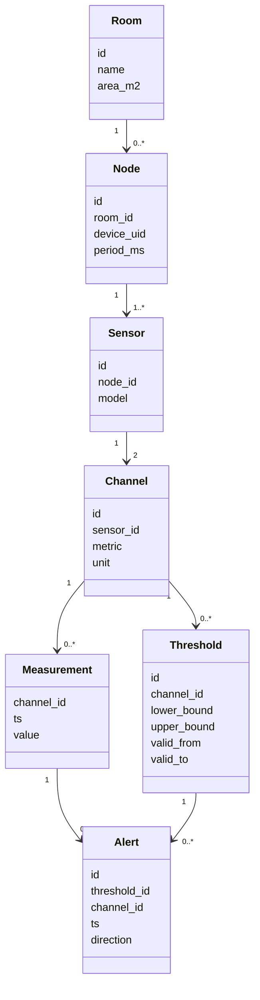

# Модель данных и правила проекта

## Предметная область

В комнате известной площади установлен узел ESP32 с датчиком DHT22. Датчик измеряет температуру и относительную влажность каждые 2000 мс. Mac получает строки через USB и отмечает момент получения в UTC. Каждое значение принадлежит отдельному каналу. Для канала задаются границы с периодом действия. Выход за границы сохраняется как предупреждение.

## Связи

| Родитель | Дочерний объект | Кратность дочерних объектов |
| --- | --- | --- |
| Room | Node | 0..* |
| Node | Sensor | 1..* |
| Sensor (DHT22) | Channel | 2: temperature и humidity |
| Channel | Measurement | 0..* |
| Channel | Threshold | 0..* |
| Threshold | Alert | 0..* |
| Measurement | Alert | 0..1 |

Внешние ключи гарантируют принадлежность дочерней записи существующему родителю. Обязательное минимальное число датчиков и каналов не обеспечивается одним FK. Первичное заполнение создаёт один DHT22 и два канала; перед сбором get_channels проверяет наличие обоих каналов и отсутствие неоднозначности датчика текущего узла.

## Ограничения

- Measurement: составной ключ (channel_id, ts); отдельная строка для каждого показателя.
- Alert: уникальность (channel_id, ts); составные FK обеспечивают связь с измерением и порогом того же канала.
- Channel: UNIQUE(sensor_id, metric), два разрешённых показателя и соответствующие единицы.
- Площадь и период измерения положительны; нижняя граница строго меньше верхней.
- Удаление связанных объектов по умолчанию NO ACTION. Историю каскадно не удаляем.
- Период правила [valid_from, valid_to); NULL означает бессрочность. Равенство числовой границе допустимо.
- set_threshold добавляет период позже существующих и закрывает прежнее бессрочное правило. Старые измерения и предупреждения сохраняются.
- Ручное редактирование SQL может создать пересекающиеся пороги; check_threshold обнаруживает это и отменяет сохранение текущей пары.

## Передача данных

Формат: `Temperature: 23.50 C | Humidity: 44.80 %`. Строки других форматов, нечисловые/нефинитные и явно выходящие за диапазон датчика значения отбрасываются. Порог комфорта и проверка входного диапазона — разные проверки.

Метка времени — приём на Mac, а не точное время измерения ESP32. Общие часы платы не синхронизируются. При сбое связи сохранённая история остаётся; пропущенные показания автоматически не восстанавливаются. USB — выбранный транспорт проекта; MQTT можно добавить позже.

## Соответствие подходу лекций

Предметная область → UML → DDL; PK/FK/CHECK/UNIQUE; UTC; параметризованные запросы; транзакции; Jupyter для демонстрации; модули db.py/repo.py и отдельный schema.sql. GUI будет отдельным этапом через Qt Designer и PySide6. Самих презентаций в репозитории нет; выводы основаны на ранее подготовленной памятке.
