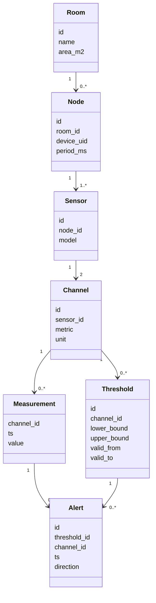

# Мониторинг микроклимата в комнате

Курсовой проект: ESP32 считывает температуру и влажность с DHT22 и отправляет показания по USB. В Jupyter данные записываются в SQLite. Если значение выходит за заданные границы, в базе появляется предупреждение. Графический интерфейс пока не сделан.

В папке четыре файла:

- `01_database.ipynb` — создание таблиц, начальные данные и запросы к базе.
- `02_receive_data.ipynb` — чтение ESP32, сохранение показаний и проверка порогов.
- `microclimate.db` — база с собранными показаниями.
- `README.md` — описание проекта, UML и код платы.

## Запуск

Используется окружение conda `microclimate` с Python 3.12. В нём нужны `pyserial`, `notebook` и `ipykernel`. SQLite входит в Python. Если библиотек нет, в терминале активного окружения выполни:

```bash
python -m pip install pyserial notebook ipykernel
```

Открой эту папку в VS Code и выбери ядро microclimate. Сначала выполни первый блокнот сверху вниз. Повторный запуск не создаёт дубликаты справочных данных. Затем подключи плату, закрой монитор порта Arduino IDE и выполни второй блокнот. Порт указан в его первой ячейке; при необходимости замени его на свой. Рабочей папкой Jupyter должна быть папка с этими четырьмя файлами.

Сбор ограничен пятью парами. Если данные не поступают 15 секунд, он останавливается. Без платы можно пропустить сбор и посмотреть сохранённые измерения. После закрытия соединения повторный запуск начинай с первой ячейки.

Время в базе хранится в UTC. Это время получения показаний компьютером. Начальные границы 20–26 °C и 40–60 % выбраны для демонстрации, а не взяты из нормативов. Равенство границе допустимо. Новые пороги не применяются задним числом. Во втором блокноте есть функция смены границ с сохранением истории.

## UML

Один DHT22 имеет два канала: температуру и влажность. Каждое значение хранится отдельной строкой. Предупреждение связано с конкретным измерением и правилом, которое действовало в тот момент.



Площадь относится к комнате. У измерения составной ключ `(channel_id, ts)`. Внешние ключи связывают таблицы, а ограничения CHECK проверяют допустимые значения полей. Период порога — от valid_from включительно до valid_to исключительно; пустое valid_to означает, что окончание не задано. Количество каналов дополнительно проверяется в коде.

## ESP32 и DHT22

DATA датчика подключён к GPIO4, питание — 3.3 В, общий провод — GND. В Arduino IDE нужны поддержка плат ESP32, Adafruit DHT sensor library и Adafruit Unified Sensor. Если плата уже передаёт показания, заново загружать код не нужно.

Код прошивки оставлен здесь, чтобы в папке не было отдельного файла:

```cpp
#include <DHT.h>

#define DHT_PIN 4
#define DHT_TYPE DHT22

DHT dht(DHT_PIN, DHT_TYPE);

void setup() {
  Serial.begin(115200);
  dht.begin();
}

void loop() {
  delay(2000);

  float temperature = dht.readTemperature();
  float humidity = dht.readHumidity();

  if (isnan(temperature) || isnan(humidity)) {
    Serial.println("DHT22 read error");
    return;
  }

  Serial.print("Temperature: ");
  Serial.print(temperature);
  Serial.print(" C | Humidity: ");
  Serial.print(humidity);
  Serial.println(" %");
}```
